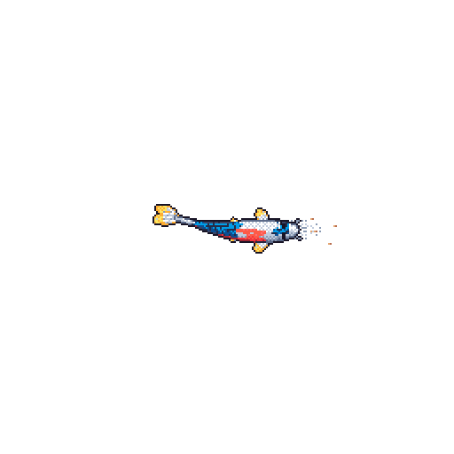

<!-- Animated SVG cards are rendered by scripts/render_readme_cards.py from data/contributions.json
     and refreshed daily by .github/workflows/update-profile-cards.yml. -->

 

 

## Featured Repositories

 

## 💫 About Me

<table>
<tr>
<td valign="top" width="50%">

**🔭 I'm currently working on:**
Building backend and cloud infrastructure

**👯 I'm looking to collaborate on:**
Backend development and cloud architecture projects

**🤝 I'm looking for help with:**
Cloud native patterns and best practices

</td>
<td valign="top" width="50%">

**🌱 I'm currently learning:**
Docker and cloud services

**💬 Ask me about:**
Python, .NET, and C# development

**⚡ Fun fact:**
I turn coffee and code into reliable cloud systems

</td>
</tr>
</table>

 

## Tech Stack

 

 

 

## 🐟 My Koi

  

